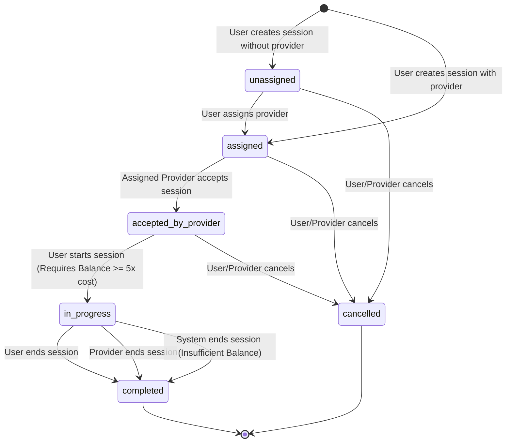
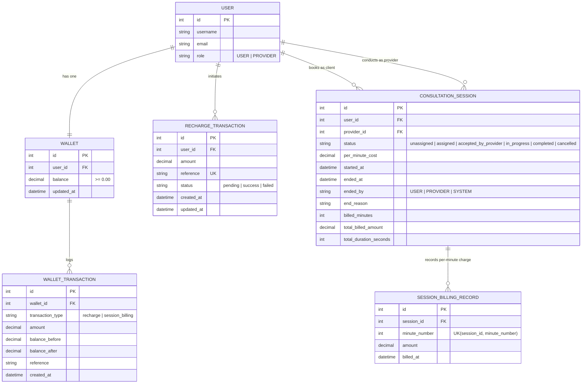

# Architecture & Implementation Decisions

This document outlines the system architecture, state machine, entity-relationship model, and critical engineering decisions for the **Django Wallet-Based Per-Minute Session Billing** system.

---

## 1. Consultation Session State Machine

The consultation session lifecycle enforces strict linear state transitions with explicit role-based permissions and automatic error handling.

### Transition Matrix & Rules

| Current State | Target State | Trigger / Action | Allowed Actor | Conditions & Validations |
| :--- | :--- | :--- | :--- | :--- |
| `None` | `unassigned` | Create Session | Client (`USER`) | Provider omitted |
| `None` | `assigned` | Create Session | Client (`USER`) | Provider specified with role `PROVIDER` |
| `unassigned` | `assigned` | Assign Provider | Client (`USER`) | Target user must have role `PROVIDER` |
| `assigned` | `accepted_by_provider` | Accept Session | Provider (`PROVIDER`) | Must be the assigned provider |
| `accepted_by_provider` | `in_progress` | Start Session | Client (`USER`) | 1. User has no other active session 2. Wallet balance >= `5 × per_minute_cost` |
| `in_progress` | `completed` | End Session | Client (`USER`) | Finalizes billing for talk time |
| `in_progress` | `completed` | End Session | Provider (`PROVIDER`) | Finalizes billing for talk time |
| `in_progress` | `completed` | Auto End | `SYSTEM` | Wallet cannot cover next minute |
| `unassigned` / `assigned` / `accepted_by_provider` | `cancelled` | Cancel Session | Client / Provider | Session must not have started |

Any invalid transition attempt (e.g., attempting to end an unstarted session, starting without provider acceptance, or assigning an active session) immediately raises an `InvalidStateTransitionError` and returns `HTTP 400 Bad Request`.

---

## 2. Entity-Relationship (ER) Diagram

---

## 3. Key Implementation Decisions

### A. Strict Database Invariant: Non-Negative Wallet Balance
- **Two-Layer Enforcement**:
  1. **Database Constraint**: `CheckConstraint(condition=Q(balance__gte=Decimal("0.00")), name="wallet_balance_non_negative")`. Even if application code were bypassed or subjected to bug conditions, the database engine prohibits negative balances at the storage level.
  2. **Application Validation**: Every debit operation checks `wallet.balance >= amount` before applying the debit within an atomic lock block.

### B. Concurrency Control and Pessimistic Locking
- High-concurrency wallet transactions are vulnerable to race conditions (e.g. concurrent billing triggers or overlapping recharges).
- **Solution**:
  - All critical state transitions, billing operations, and wallet modifications execute within `transaction.atomic()` blocks.
  - Rows are locked using `select_for_update()` on both the `Wallet` and `ConsultationSession` records.
  - This serializes concurrent requests for the same wallet or session, preventing race conditions such as double-spending.

### C. Recharge Callback Idempotency
- **Problem**: Payment gateways frequently resend webhook/callback notifications due to network delays or retries.
- **Solution**:
  - `RechargeTransaction.reference` is defined with a database-level `unique=True` index.
  - In `process_recharge_callback(reference, status)`:
    - The transaction record is locked with `select_for_update()`.
    - If `recharge.status == RechargeStatus.SUCCESS`, the system immediately returns with `newly_credited = False` and skips crediting the wallet.
    - Only an initial transition from `pending` -> `success` credits the wallet.
  - Guarantees that processing the same webhook $N$ times will credit the wallet exactly once.

### D. Discrete Per-Minute Billing Engine & Duplicate Billing Prevention
- **Problem**: In a per-minute billing system, billing could be triggered multiple times for the same time window, resulting in double charging.
- **Solution**:
  - The billing engine assigns an ordinal `minute_number` (1, 2, 3...) to every billable minute.
  - Each charged minute creates an immutable `SessionBillingRecord`.
  - A database unique constraint `UniqueConstraint(fields=["session", "minute_number"], name="unique_session_minute_billing")` guarantees that no minute can be inserted more than once.
  - `session.billed_minutes` keeps track of the highest billed minute index. When `bill_session()` runs, it only evaluates minutes from `billed_minutes + 1` to `target_minutes`. If `target_minutes <= billed_minutes`, no charges occur.

### E. Insufficient Balance & Automatic System Termination
- **Rule**: The wallet must have at least five times the session's per-minute cost to start.
- During an ongoing session, before charging minute $M$:
  - The engine checks `wallet.balance >= session.per_minute_cost`.
  - If insufficient:
    - The wallet is **NOT** debited for that unpaid minute (preventing negative balance).
    - The session is immediately terminated with `status = 'completed'`.
    - `ended_by` is recorded as `'SYSTEM'`.
    - `end_reason` is recorded as `'Insufficient Balance'`.
    - The total talk duration `total_duration_seconds` is recorded accurately.

### F. Dual-Role Architecture (USER vs PROVIDER)
- The system implements a custom `User` model inheriting from Django's `AbstractUser` with a `role` field (`USER` or `PROVIDER`).
- Access control ensures:
  - Only `USER` accounts can book sessions and start them.
  - Only the assigned `PROVIDER` can accept assigned sessions.
  - Both `USER` and `PROVIDER` can end an active session.
  - A user cannot have multiple simultaneous `in_progress` sessions.
