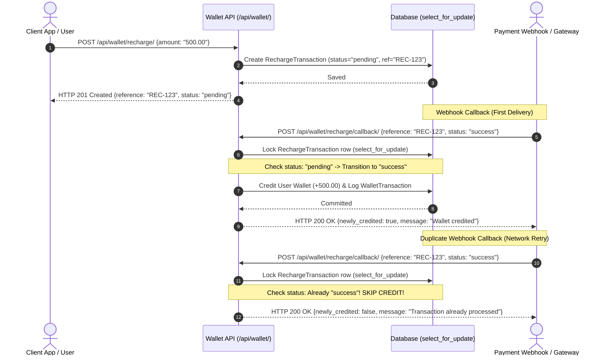
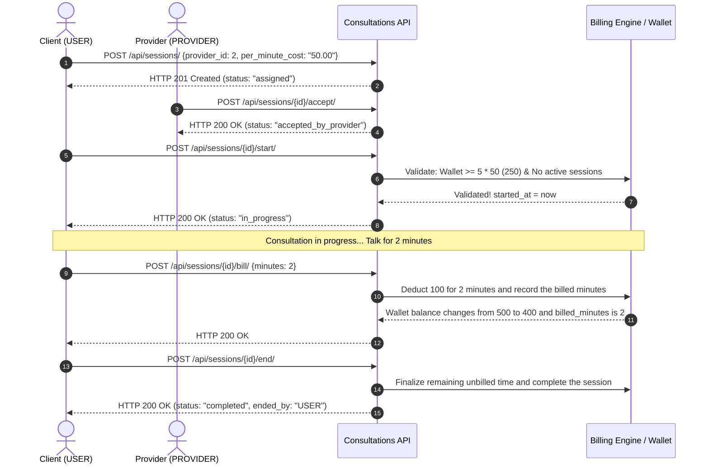
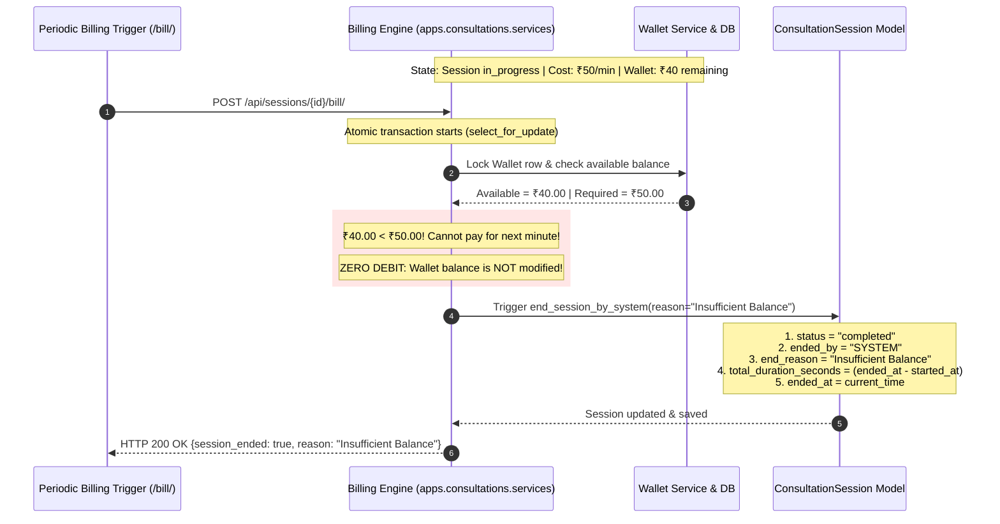
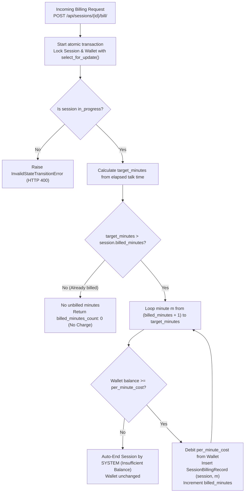

# Django Wallet-Based Per-Minute Session Billing

A robust backend system for paid 1:1 consultation sessions featuring prepaid wallet balance management, lifecycle state machine enforcement, synchronous per-minute billing, idempotency guarantees, and automated session termination on insufficient balance.

---

## Project Folder Structure

This uses a standard Django layout: `config` contains project settings, while `users`, `wallets`, and `consultations` are separate apps for each domain.

```text
Assignment/
├── manage.py                 # Django command line utility
├── requirements.txt          # Python dependencies
├── config/                   # Project settings and root URLs
│   ├── settings.py
│   ├── urls.py
│   ├── asgi.py
│   └── wsgi.py
├── users/                    # User model, roles, login, registration
├── wallets/                  # Wallet, recharge, and ledger transaction logic
├── consultations/            # Session lifecycle, state machine, and billing engine
├── tests/                    # Automated API and business logic tests
├── ARCHITECTURE.md           # State diagram, ER diagram, and design decisions
└── README.md                 # Setup, system flows, and API guide
```

Each app keeps its own `models.py`, `views.py`, `serializers.py`, `services.py`, `urls.py`, and `migrations/` folder. This makes each part isolated, testable, and maintainable.

---

## Table of Contents
1. [Tech Stack](#tech-stack)
2. [Key Features & Rules](#key-features--rules)
3. [Core System Flows & Step-by-Step Walkthroughs](#core-system-flows--step-by-step-walkthroughs)
   - [Flow 1: Mock Wallet Recharge & Idempotency Flow](#flow-1-mock-wallet-recharge--idempotency-flow)
   - [Flow 2: Complete Happy Path Consultation Flow](#flow-2-complete-happy-path-consultation-flow)
   - [Flow 3: Per-Minute Billing & Insufficient Balance Auto-Termination Flow (Mid-Session)](#flow-3-per-minute-billing--insufficient-balance-auto-termination-flow-mid-session)
   - [Flow 4: Concurrency & Duplicate Billing Prevention Flow](#flow-4-concurrency--duplicate-billing-prevention-flow)
   - [Flow 5: Session Cancellation Flow](#flow-5-session-cancellation-flow)
4. [Setup & Installation](#setup--installation)
5. [Running the Test Suite](#running-the-test-suite)
6. [Required Test Scenarios Verification](#required-test-scenarios-verification)
7. [API Documentation](#api-documentation)
8. [System Architecture & State Machine](#system-architecture--state-machine)
9. [Important Implementation Decisions](#important-implementation-decisions)

---

## Tech Stack
- **Framework**: Django 5.x / 6.x
- **API Engine**: Django REST Framework (DRF)
- **Authentication**: Token Authentication (`rest_framework.authtoken`) & Session Authentication
- **Database**: SQLite (default for development/testing); fully compatible with PostgreSQL
- **Testing**: Django Test Runner & Python `unittest` (`rest_framework.test.APITestCase`)
- **Code Coverage**: `coverage` (90% test coverage)

---

## Key Features & Rules

1. **Prepaid Wallet**:
   - Every user has an automatically provisioned wallet.
   - Database constraint + transaction-level checks guarantee balance **never becomes negative**.
   - Immutable audit ledger (`WalletTransaction`) tracking all credit and debit events.
2. **Mock Recharge Flow & Idempotency**:
   - Initiation endpoint creates pending transaction references.
   - Webhook/callback endpoint processes completion.
   - **Idempotency Guarantee**: Duplicate successful callbacks are recognized and credit the user's wallet **only once**.
3. **Session State Machine**:
   - Defined lifecycle: `unassigned` &rarr; `assigned` &rarr; `accepted_by_provider` &rarr; `in_progress` &rarr; `completed` (plus `cancelled`).
   - Role enforcement: Client (`USER`) vs. Provider (`PROVIDER`).
   - A user cannot have more than one active (`in_progress`) session concurrently.
   - Fixed per-minute cost once session starts.
   - Minimum balance requirement: the wallet needs at least five times the session's per-minute cost to start.
   - Invalid transitions return `HTTP 400 Bad Request` with meaningful error descriptions.
4. **Per-Minute Billing Engine**:
   - Synchronous billing mechanism triggered periodically during an active session (`POST /api/sessions/<id>/bill/`).
   - Granular itemized billing tracking via `SessionBillingRecord`.
   - Database unique constraint on `(session_id, minute_number)` guarantees no minute is ever billed twice.
5. **Automatic Termination on Insufficient Balance**:
   - If the wallet cannot cover the next minute during an active session:
     - The wallet is **NOT** debited for that unpaid minute (remains non-negative).
     - The session is terminated automatically with status `completed`.
     - `ended_by = SYSTEM` and `end_reason = Insufficient Balance` are recorded.
     - Talk time (`total_duration_seconds`) and all prior successfully billed minutes are persisted.

---

## Core System Flows & Step-by-Step Walkthroughs

### Flow 1: Mock Wallet Recharge & Idempotency Flow

This flow allows a user to add funds to their wallet, with full idempotency protection against duplicate webhook deliveries.



**Step-by-Step Logic**:
1. **Initiate**: The user calls `POST /api/wallet/recharge/`. A `RechargeTransaction` is created with unique reference `REC-XXXX` and `status = pending`.
2. **First Webhook**: The gateway delivers `status = success`. The service acquires a row-level lock (`select_for_update`), detects `status == pending`, atomically credits the user's wallet, records a `WalletTransaction` ledger entry, and marks the transaction `success`.
3. **Duplicate Webhook**: If the gateway resends the callback (due to timeout or retry), the service locks the record, sees `status == success`, and **returns immediately without crediting the wallet a second time**.

---

### Flow 2: Complete Happy Path Consultation Flow

The standard lifecycle from session creation to normal completion.



**Step-by-Step Logic**:
1. **Create Session**: The client creates a session. With a provider specified, status is initialized as `assigned`.
2. **Provider Acceptance**: The assigned provider calls `POST /api/sessions/<id>/accept/`. Status transitions to `accepted_by_provider`.
3. **Start Session**: Client calls `POST /api/sessions/<id>/start/`. The system verifies:
   - Wallet balance is at least five times the per-minute cost (e.g. ₹250 for a ₹50/min rate).
   - User has no other session currently `in_progress`.
   - On success, `started_at` is set, `per_minute_cost` is locked, and status becomes `in_progress`.
4. **Billing**: During the session, billing occurs synchronously for elapsed minutes (e.g., 2 minutes &rarr; ₹100 debited).
5. **End Session**: Either the client or provider calls `POST /api/sessions/<id>/end/`. Final unbilled time is calculated, talk duration `total_duration_seconds` is persisted, and status becomes `completed`.

---

### Flow 3: Per-Minute Billing & Insufficient Balance Auto-Termination Flow (Mid-Session)

When an active session's wallet can no longer cover the next minute, the system terminates the session automatically, preserves the remaining balance, and logs the audit reason.



**Step-by-Step Logic**:
1. **Threshold Reached**: Suppose per-minute cost is ₹50. The client started with ₹290, and 5 minutes (₹250) have elapsed and been billed. Remaining wallet balance is **₹40.00**.
2. **Next Minute Check**: Minute 6 arrives. Periodic billing executes `POST /api/sessions/<id>/bill/`.
3. **Pessimistic Lock**: The engine locks both `ConsultationSession` and `Wallet` using `select_for_update()`.
4. **Insufficient Balance Detection**: The engine checks `wallet.balance >= session.per_minute_cost`. Because ₹40.00 < ₹50.00, the condition is `False`.
5. **Zero Deduction**: The wallet is **NOT** debited for minute 6. The balance remains ₹40.00 (non-negative constraint preserved).
6. **Automatic System Termination**: `end_session_by_system()` executes:
   - `status = "completed"`
   - `ended_by = "SYSTEM"`
   - `end_reason = "Insufficient Balance"`
   - `total_duration_seconds` is recorded based on actual elapsed seconds.
7. **API Response**: Returns `{"billing_summary": {"session_ended": true, "reason": "Insufficient Balance"}}`.

---

### Flow 4: Concurrency & Duplicate Billing Prevention Flow

How the system guarantees that no minute is charged twice, even under repeated or concurrent billing calls.



**Key Safety Mechanisms**:
- **Database Unique Constraint**: `SessionBillingRecord` enforces `UniqueConstraint(fields=["session", "minute_number"])`. The database rejects any duplicate insert for the same minute number.
- **Incremental Counter**: `session.billed_minutes` keeps track of the highest billed minute index. Retrying the same billing call is a safe, zero-cost no-op.

---

### Flow 5: Session Cancellation Flow

Rules for cancelling a session before it begins.

- **Allowed From**: `unassigned`, `assigned`, or `accepted_by_provider`.
- **Actor Allowed**: Client owner, assigned provider, or admin.
- **Action**: Transitions status to `cancelled` and records `end_reason`.
- **Prohibited**: Calling `/cancel/` on an `in_progress` session returns `HTTP 400 Bad Request`. Active sessions must be concluded through `/end/` to ensure accurate billing finalization.

---

## Setup & Installation

### 1. Prerequisites
- Python 3.10+ (tested on Python 3.12)
- Git

### 2. Clone Repository & Setup Virtual Environment
```bash
git clone <repository-url>
cd Assignment

# Create virtual environment
python3 -m venv venv

# Activate virtual environment
# On macOS / Linux:
source venv/bin/activate
# On Windows:
# venv\Scripts\activate

# Install dependencies
pip install -r requirements.txt
```

### 3. Run Database Migrations
```bash
python manage.py migrate
```

### 4. Seed Demo Data (Optional but Recommended)
Populates demo users (Client `client1` with ₹500 funded wallet, Providers `dr_sarah` and `dr_alex`):
```bash
python manage.py seed_demo_data
```

### 5. Start Development Server
```bash
python manage.py runserver
```
The API is now running at `http://127.0.0.1:8000/`.

### 6. Interactive Swagger & OpenAPI Documentation
Browse and test all endpoints interactively:
- **Swagger UI**: `http://127.0.0.1:8000/api/docs/`
- **OpenAPI Schema**: `http://127.0.0.1:8000/api/schema/`
- Click the **Authorize** button in Swagger UI and provide `Token <your_token>` to test authenticated requests directly from your browser.

---

## Run with Docker Compose

Docker Compose builds the image, applies migrations, and starts Django on port 8000. SQLite data is kept in the named `wallet_db` volume.

```bash
docker compose up --build
```

Open the API at `http://localhost:8000/` and Swagger at `http://localhost:8000/api/docs/`. Stop the server with `Ctrl+C`; use `docker compose down` to remove the container. The database volume remains, so data is preserved across restarts. To also delete the stored database, use `docker compose down -v`.

The Compose configuration is for local development and uses Django's development server. Set `DJANGO_SECRET_KEY` in your shell before starting if you want to override the local development key.

## Browser API Playground

Open `http://localhost:8000/` while the Django server is running. Create or sign in to a customer and provider account, then switch the **Acting as** selector to perform provider actions. The page sends real requests to this Django API and displays each request and response. Tokens stay in the current browser tab and are not sent to any service other than this app.

### Demo the session and minute billing

1. Sign in or create a customer and provider account.
2. As the customer, request a recharge and click **Mock success callback** to credit the wallet. (This simulates the payment provider's callback; no real payment is made.)
3. Create a session and assign a provider. Switch **Acting as** to the provider and click **Provider accepts**. Switch back to the customer and click **Start session**.
4. Click **Charge next minute** to simulate one more elapsed minute. Each click calls the real bill API for the next minute and charges one minute at the displayed per-minute price. For example, the first click bills minute 1 and the second click bills minute 2. Repeating a minute through **Bill elapsed minutes** does not charge it twice. You can also set **Bill through minute** manually to simulate several elapsed minutes at once.
5. Click **End session** to finish. To demo automatic stopping when funds run out, recharge with a small amount, use a higher per-minute price, and bill past what the wallet can cover. The API completes the session without making the balance negative.

Minute billing in this playground is triggered manually so the flow can be demonstrated on demand. It does not run a background timer; the bill-through-minute value simulates elapsed time while each button invokes the real Django API.

## Running the Test Suite

Run the full automated test suite containing 30 comprehensive unit and integration tests:

```bash
# Run tests
python manage.py test tests -v 2
```

### Running with Code Coverage
```bash
# Run with coverage measurement
coverage run manage.py test tests

# View terminal coverage report
coverage report --include="users/*,wallets/*,consultations/*"

# (Optional) Generate HTML coverage report
coverage html --include="users/*,wallets/*,consultations/*"
```
The test suite achieves **90% code coverage** across all applications.

---

## Required Test Scenarios Verification

All 6 test scenarios explicitly requested in the assignment are fully covered by automated tests:

| # | Assignment Requirement | Test Method | Test File | Status |
|---|---|---|---|:---:|
| **1** | **Insufficient balance**:<br>User with < 5 minutes' worth of balance cannot start a session. | `test_scenario_1_user_with_less_than_5_minutes_balance_cannot_start_session`<br>`test_scenario_1_api_insufficient_balance_returns_400` | `tests/test_insufficient_balance.py` | ✅ **PASS** |
| **2** | **Happy path**:<br>Recharge wallet &rarr; Create session &rarr; Provider accepts &rarr; Start session &rarr; Billing occurs for 2 minutes &rarr; End session. Verify wallet debited correctly. | `test_scenario_2_complete_happy_path_flow` | `tests/test_end_to_end_flow.py` | ✅ **PASS** |
| **3** | **Balance runs out**:<br>During active session, wallet cannot cover next minute. Verify session ends automatically, wallet is not negative, correct ending reason recorded. | `test_scenario_3_balance_runs_out_during_active_session`<br>`test_scenario_3_api_balance_runs_out_ends_session_by_system` | `tests/test_insufficient_balance.py` | ✅ **PASS** |
| **4** | **Invalid state transition**:<br>Attempt invalid action (e.g. ending session before started). Verify request returns `HTTP 400`. | `test_scenario_4_invalid_state_transition_ending_before_start_raises_error`<br>`test_scenario_4_api_ending_before_start_returns_400` | `tests/test_session_state_machine.py` | ✅ **PASS** |
| **5** | **Duplicate recharge callback**:<br>Process same successful recharge callback twice. Verify wallet credited only once. | `test_scenario_5_duplicate_recharge_callback_credits_only_once`<br>`test_initiate_and_complete_recharge_via_api` | `tests/test_recharge_idempotency.py` | ✅ **PASS** |
| **6** | **Duplicate billing**:<br>Trigger billing more than once for same billable minute. Verify user is not charged twice. | `test_scenario_6_duplicate_billing_does_not_charge_twice`<br>`test_scenario_6_api_duplicate_billing_does_not_charge_twice` | `tests/test_per_minute_billing.py` | ✅ **PASS** |

---

## API Documentation

Except registration, login, and the mock payment callback, endpoints require `Authorization: Token <token>`. Registration and login return uppercase roles: `USER` or `PROVIDER`. Decimal money values are sent as strings (for example, `"50.00"`).

### Authentication

| Method and path | Request JSON | Success response |
|---|---|---|
| `POST /api/auth/register/` | `{"username":"client_demo","password":"password123","role":"USER","email":"client@example.com"}` (`email` optional; role defaults to `USER`) | `id`, `username`, `email`, `role`, `token` |
| `POST /api/auth/login/` | `{"username":"client_demo","password":"password123"}` | `token`, `user_id`, `username`, `role` |
| `GET /api/auth/me/` | No body | User details and `wallet_balance` |
| `GET /api/auth/providers/` | No body | Array of provider details |

### Wallet and Recharge

| Method and path | Request JSON | Success response / notes |
|---|---|---|
| `GET /api/wallet/` | No body | Wallet id, user id, username, balance, update time, and up to 10 recent transactions |
| `GET /api/wallet/transactions/` | No body | Array of wallet ledger records |
| `GET /api/wallet/recharges/` | No body | Array of current user's recharge records |
| `POST /api/wallet/recharge/` | `{"amount":"250.00"}` (optional `reference`) | HTTP 201; recharge `id`, `amount`, `reference`, `status`, `created_at`, `updated_at` |
| `POST /api/wallet/recharge/callback/` | `{"reference":"REC-...","status":"success"}` (`status` is `success` or `failed`) | `message`, `transaction`, and `newly_credited`; repeat successful callbacks do not credit twice |

The callback is a mock webhook and is intentionally unauthenticated for this assignment. It returns HTTP 404 for an unknown reference and HTTP 400 for an invalid status.

### Consultation Sessions

| Method and path | Request JSON | Success response / notes |
|---|---|---|
| `GET /api/sessions/` | No body | Array of sessions belonging to the authenticated user or provider |
| `POST /api/sessions/` | `{"provider_id":2,"per_minute_cost":"50.00"}`; both fields optional (`provider_id` omitted means unassigned) | HTTP 201; session details including status, timestamps, bill totals, and billing records |
| `GET /api/sessions/{id}/` | No body | Session details; only participants or staff can view |
| `POST /api/sessions/{id}/assign/` | `{"provider_id":2}` | Assigns provider; session becomes `assigned` |
| `POST /api/sessions/{id}/accept/` | No body | Assigned provider accepts; status becomes `accepted_by_provider` |
| `POST /api/sessions/{id}/start/` | No body | User starts; requires wallet balance of at least 5 × session price and no other active session |
| `POST /api/sessions/{id}/bill/` | `{"minutes":2}` (optional whole-minute count or simulated timestamp) | `billing_summary` and updated `session`; retrying same elapsed minute does not charge twice |
| `POST /api/sessions/{id}/end/` | No body | Bills elapsed whole minutes, then completes session unless already ended by system |
| `POST /api/sessions/{id}/cancel/` | No body | Cancels a session that has not started |

---

## System Architecture & State Machine

See [ARCHITECTURE.md](ARCHITECTURE.md) for full diagrams and in-depth notes.

```
unassigned
   ↓ (Assign Provider)
assigned
   ↓ (Provider Accepts)
accepted_by_provider
   ↓ (User Starts - Balance >= 5x cost)
in_progress
   ↓ (User / Provider Ends OR System Ends on Insufficient Balance)
completed
```

---

## Important Implementation Decisions

1. **Database-Level Non-Negative Check Constraint**:
   Using `CheckConstraint(condition=Q(balance__gte=Decimal("0.00")), name="wallet_balance_non_negative")` guarantees that balance can never drop below zero under any concurrency or race scenario.
2. **Pessimistic Concurrency Locking**:
   Critical wallet operations, state transitions, and billing calculations use `select_for_update()` inside `transaction.atomic()` to prevent race conditions (double-charging or double-spending).
3. **Idempotency in Recharge Callbacks**:
   `RechargeTransaction.reference` is uniquely indexed. When callbacks arrive, checking the locked transaction status prevents duplicate wallet credits.
4. **Itemized Billing Records (`SessionBillingRecord`)**:
   Instead of solely maintaining a numeric counter, every billed minute is individually recorded in `SessionBillingRecord` with a unique database constraint on `(session_id, minute_number)`. This guarantees duplicate charges for the same minute are mathematically and architecturally impossible.
5. **Graceful Insufficient Balance Handling**:
   When the wallet cannot pay for the next billable minute during an ongoing session, billing stops immediately without charging that minute, the wallet balance is preserved, and the session is transitioned to `completed` with `ended_by = SYSTEM` and `end_reason = Insufficient Balance`.
